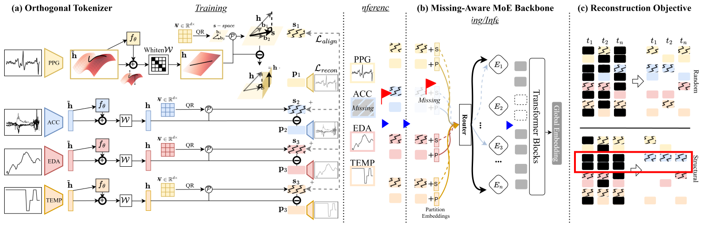

# VCR
Official implementation of our NeurIPS 2026 paper: 
[**VCR: Learning Valid Contextual Representation for Incomplete Wearable  Signals**](https://neurips.cc/virtual/2026/loc/sydney/poster/155491)



## Abstract
Wearable devices enable continuous health monitoring from multimodal signals, but real-world deployment is hindered by limited labeled data and pervasive sensor incompleteness. While large-scale self-supervised pretraining reduces label dependence, most existing methods assume full modality availability. Current approaches for handling modality missingness often reconstruct entire absent signals, which can encourage hallucinating modality-specific details that are not inferable from the observed sensor signals and degrade robustness. We propose VCR, a self-supervised framework that learns to extract valid representations robust to modality missingness. VCR employs an orthogonal tokenizer to enforce strict orthogonal disentanglement by rectifying latent manifolds and applying a geometric projection, separating each modality into shared semantics and modality-specific residuals. This design preserves complete information integrity while serving as a structural foundation for robust learning under modality missingness. The resulting tokens are processed by a missing-aware mixture-of-experts backbone that adapts to varying patterns of modality availability. By constraining the objective to reconstruct only the shared components of missing modalities, VCR effectively mitigates hallucinations of non-inferable modality-specific details. Across multiple health monitoring tasks, VCR consistently improves performance and robustness under full, single-missing, and multiple-missing modality settings compared with strong supervised and self-supervised baselines.

---

## Environment Setup
Our implementation is developed with the following environment:
- **OS:** Ubuntu 22.04
- **Python:** 3.12
- **PyTorch:** 2.8.0
- **CUDA:** 12.8

## Model Training
### 1. Prepare Pre-training Data
The raw wearable-sensor recordings are converted into HDF5 format using the following preprocessing scripts:

```bash
python public_code/preprocess_bigideas.py
python public_code/preprocess_canstress.py
python public_code/preprocess_ue4w.py
```

Sample rates of each modality:
- PPG: 64 Hz
- EDA: 4 Hz
- ACC: 32 Hz
- TEMP: 4 Hz

The generated HDF5 files generally follow this structure:
```
dataset.h5
├── metadata
│   └── sampling_rates
└── S001
    ├── sample_00000
    │   ├── ppg
    │   ├── eda
    │   ├── acc
    │   └── temp
    ├── sample_00001
    └── ...
```

### 2. Train the Orthogonal Tokenizer
`train.py` and `config.py` are the training and configuration scripts specifically for Orthogonal Tokenizer training. After setting hyperparamters, directly run:
```bash python train.py
```
We recommend training on **1 × NVIDIA RTX 5090 (or better)** GPUs.

